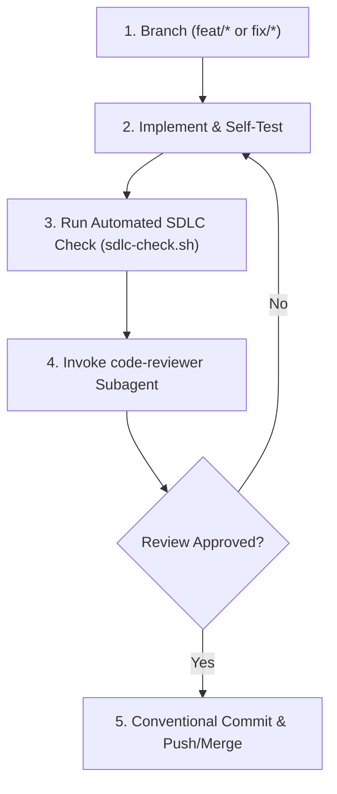

# Git & GitHub SDLC Runbook

This skill outlines the strict 5-step SDLC process that must be followed for every feature, bugfix, or enhancement in the DhakaSpace repository.

## SDLC 5-Step Process



### Step 1: Feature Branching
Always create a descriptive branch from up-to-date `main`:
```bash
git checkout main
git checkout -b feat/<feature-name>
```

### Step 2: Implementation & Self-Test
Write code following project rules in `AGENTS.md`. Verify TypeScript builds and tests run cleanly.

### Step 3: Run Automated SDLC Check
Run the bundled verification script:
```bash
./.agents/plugins/dhaka-sdlc-kit/skills/git-github-sdlc/scripts/sdlc-check.sh
```
This script validates:
- No sensitive files (`.env`, `*.pem`, `*.key`) are staged or tracked.
- Git repository status is healthy and on a valid branch.
- Monorepo package files have valid JSON syntax.

### Step 4: Invoke the Code-Reviewer Subagent
Before committing, invoke the `code-reviewer` subagent:
- Prompt the subagent with the output of `git status -s` and `git diff`.
- Check its findings for security vulnerabilities, MERN bugs, or deprecated Gemini models.
- If changes are requested, fix them and re-run the check.

### Step 5: Conventional Commit & GitHub Synchronization
Once approved by `code-reviewer`:
```bash
git add <files>
git commit -m "feat(scope): concise description"
git push -u origin <branch-name>
```
When opening a pull request on GitHub, fill out `.github/pull_request_template.md`.
